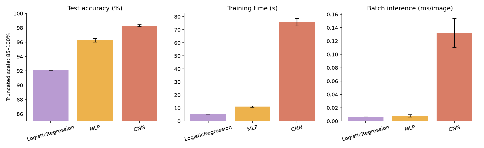

## Порівняння трьох моделей: якість, швидкість і складність

Основні три різні моделі — LogisticRegression, MLP та CNN. CNN_aug — додаткова умова навчання CNN, а не четверта архітектура.

| Модель | Accuracy, % | Macro-F1 | Навчання, с | 1 цифра, мс | Batch, мс/цифру | Параметри | Файл, KiB |
| --- | ---: | ---: | ---: | ---: | ---: | ---: | ---: |
| LogisticRegression | 92.08 (1 запуск) | 0.9197 | 5.21 (1 запуск) | 0.7490 (1 запуск) | 0.0063 (1 запуск) | 7850 | 31.6 |
| MLP | 96.26 ± 0.25 | 0.9622 | 11.11 ± 0.45 | 0.4581 ± 0.1915 | 0.0077 ± 0.0019 | 109386 | 430.0 |
| CNN | 98.29 ± 0.14 | 0.9828 | 75.70 ± 2.82 | 0.9135 ± 0.3850 | 0.1320 ± 0.0217 | 52138 | 207.0 |

У таблиці та error bars показано mean ± sample std між трьома seeds; для регресії один запуск і std між seeds не визначено. Для inference спочатку взято медіану 7 повторів кожного checkpoint. Це описовий розкид, а не довірчий інтервал. На графіку accuracy вісь починається з 85%, інші осі — з нуля.

### Протокол швидкодії

Навчання — фактичний час уже завершених запусків: середнє трьох seeds для нейромереж і один запуск регресії. Це історичні wall-clock вимірювання, без повторного хронометражу навчання; для нейромереж вони включають training loop, validation, запис checkpoint та історій і можуть залежати від фонового навантаження. Регресія використовує L-BFGS, нейромережі — 6 епох Adam, тому це ціна конкретних рецептів, а не однаковий оптимізаційний бюджет.

Прогнозування виміряне окремо скриптом `benchmark.py` на CPU: 2 потоки PyTorch та обмеження BLAS/OpenMP до 2 потоків, 3 прогрівальні batch-виклики та 7 повторів для кожного checkpoint. Медіана часу повторів обчислена всередині запуску, потім усереднена між seeds. Сім повторів часу не є сімома незалежними навчаннями. Сирі значення, квартилі та std між seeds збережені в CSV.

Режим «1 цифра» — 100 послідовних викликів batch=1 на перших 100 test-зображеннях; наведено середній час одного виклику всередині вимірювання. Batch — усі 10000 test-зображень блоками до 256; наведено амортизований час на зображення, а не затримку одного запиту. Вхід float32 [0,1] уже в RAM. Включено фіксовану нормалізацію нейромереж, predict_proba/softmax та argmax. Завантаження ваг, читання даних, сегментація й браузер не включені. Перед хронометражем прогнози кожного checkpoint звірено зі збереженими test-прогнозами; ваги не змінюються. Порядок моделей фіксований, результати залежать від процесора й навантаження; це не універсальний рейтинг швидкості.

Повне середовище та SHA-256 ваг — `artifacts/benchmark_protocol.json`; сирі часи — `benchmark_raw.csv`; медіани та квартилі — `benchmark_runs.csv`; підсумок — `model_comparison.csv`. Розмір файлу включає метадані серіалізації, для PyTorch також структуру checkpoint; це не пікова RAM і не чистий розмір ваг.

### Як визначено складність

Логістична регресія має один лінійний шар оцінок класів. MLP додає нелінійні повнозв'язні шари; CNN — дві згортки й pooling для просторових ознак. Параметрів відповідно 7850, 109386 та 52138. Отже, складніша архітектура не обов'язково має більше параметрів: CNN повторно використовує ті самі ядра у багатьох позиціях.

Аналітична оцінка multiply-accumulate для Linear/Conv2d на зображення: 7840, 109184 та 333056 MAC відповідно. Це лише оцінка цих шарів: bias, pooling, активації, softmax, переміщення пам'яті й накладні витрати бібліотек не враховані. Вона пояснює можливе зростання обчислень попри меншу кількість ваг CNN; не підміняє виміряний час.

### Практичний висновок

Найвища середня test accuracy серед основних трьох моделей — у CNN. Порівняно з MLP приріст становить 2.03 відсоткового пункту, а історичне навчання тривало приблизно у 6.8 раза довше. Найменший виміряний середній час навчання — LogisticRegression; single-прогнозу — MLP; batch-прогнозування — LogisticRegression. Розкид часу суттєвий; без контрольованого повторення на вільному процесорі це опис вимірювань, а не доведена стабільність рейтингу. Режими також відрізняються через накладні витрати та ефективність пакетних операцій.

Для простого baseline доречна регресія, для проміжного компромісу — MLP, для пріоритету якості в цьому протоколі — CNN. Вибір моделі для демонстрації здійснюється за validation macro-F1, а не за test. Додаткова аугментація оцінюється окремо за стійкістю. Ці вимірювання стосуються Python/CPU й не заявляються як швидкість або точність персональної браузерної моделі.
