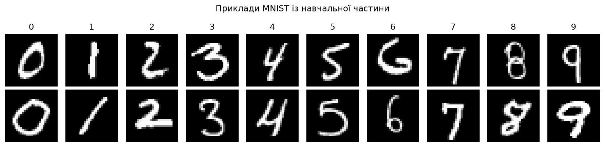
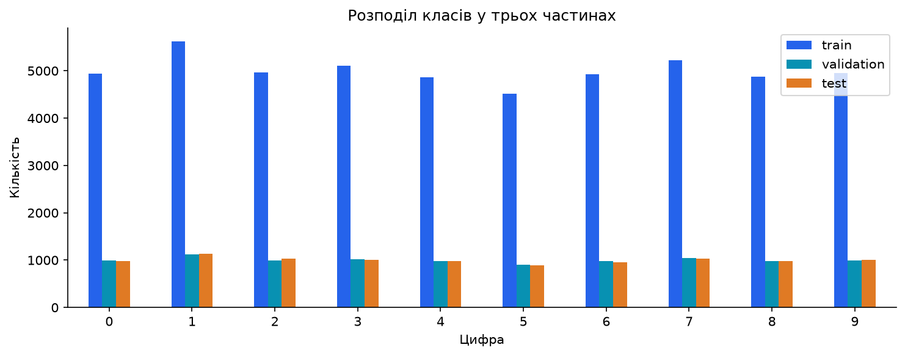

# Паспорт датасету MNIST

## Походження та задача

MNIST — підготовлені зображення рукописних цифр із мітками 0–9, створені на основі NIST Special Database 1 та 3. Зображення нормалізовані за розміром і центровані. Джерело опису: [каталог NIST](https://tsapps.nist.gov/BDbC/Search/Details/387); [оригінальна сторінка MNIST](http://yann.lecun.com/exdb/mnist/). Завантаження здійснює `torchvision.datasets.MNIST`.

Одиниця спостереження — одна цифра, а не ціле багатозначне число. Вхід: одноканальне зображення 28×28, 784 пікселі типу uint8 у діапазоні 0–255. Цільова змінна: один із десяти класів. Задача — supervised multiclass classification. Мітки вже надані авторами датасету; власного ручного маркування для основного експерименту немає.

## Розмір і поділ

Офіційні 60000 навчальних зображень поділено на 50000 train та 10000 validation зі стратифікацією й seed=42. Офіційні 10000 test збережено для фінального оцінювання. Всі три моделі отримують однакові приклади й індекси. Test не використано для вибору checkpoint чи гіперпараметрів.

Фактичний баланс класів наведено нижче та в `artifacts/class_balance.csv`:

| Цифра | Train | Validation | Test |
| --- | ---: | ---: | ---: |
| 0 | 4936 | 987 | 980 |
| 1 | 5618 | 1124 | 1135 |
| 2 | 4965 | 993 | 1032 |
| 3 | 5109 | 1022 | 1010 |
| 4 | 4868 | 974 | 982 |
| 5 | 4518 | 903 | 892 |
| 6 | 4932 | 986 | 958 |
| 7 | 5221 | 1044 | 1028 |
| 8 | 4876 | 975 | 974 |
| 9 | 4957 | 992 | 1009 |
| Разом | 50000 | 10000 | 10000 |

Дисбаланс помірний: у train найчастіша цифра 1, найрідша 5 (відношення близько 1,24). Тому звітуємо як accuracy, так і macro-F1, що дає кожному класу однакову вагу. Штучне вирівнювання класів не застосовано.

## Передобробка та контроль даних

Пікселі ділимо на 255. Для регресії використовуємо 784 ознаки у [0,1]; для нейромереж — тензор [N,1,28,28] і фіксоване масштабування до [-1,1]. Статистики validation/test не використовуються. В основних трьох моделях аугментації немає; CNN_aug — окремий додатковий контроль. Пропущених значень у щільних uint8-масивах немає. Індекси розбиття збережено в `artifacts/split.npz`, SHA-256 архівів — у `artifacts/environment.json`.

## Чому цей датасет і які обмеження

MNIST дозволяє навчити лінійну модель, MLP та CNN на одному вході й порівняти використання просторової структури зображення за доступного CPU-бюджету. Це відомий навчальний benchmark, тому новизна роботи — у власному відтворюваному порівнянні, вимірюванні витрат та аналізі помилок, а не у створенні нового датасету.

Підготовлені цифри не відтворюють фотографії, складний фон, злитий почерк чи багатозначні записи. Розбиття стратифіковано за класом, але не гарантує незалежності авторів почерку. Синтетичні числа та сайт — окремі демонстраційні розширення; точність MNIST не можна видавати за їхню точність. Персональне браузерне донавчання не входить до фіксованого порівняння моделей.
