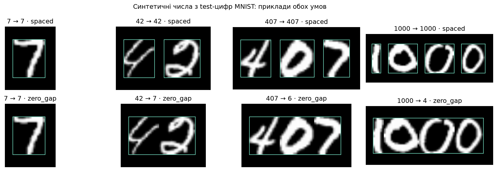

## 11. Розширення: цілі числа від 1 до 1000

### Постановка та реалізація

Модель цифр повторно використано для розпізнавання послідовностей довжиною від однієї до чотирьох цифр. 1000 окремих класів не навчалися. Пайплайн: широке полотно → очищення фону → поділ за вертикальною проєкцією → впорядкування зліва направо → передобробка кожної цифри → CNN → об'єднання top-1 прогнозів → перевірка діапазону.

Полотно UI має 840×240 пікселів. Поріг foreground — 40 у шкалі 0…255; видаляються 8-зв'язні компоненти площею меншою за max(6,0.002×кількість foreground-пікселів). Сусідні зайняті вертикальні ділянки об'єднуються, якщо порожній проміжок не перевищує max(4 px, round(0.035×висота foreground)). Це допомагає зберігати розірвані штрихи однієї цифри, але може помилково об'єднати надто близькі цифри. Повертаються рамки [x,y,width,height], входи моделі й top-3 кожної цифри. Геометрична сегментація є передобробкою; алгоритми класифікації та градієнти з нуля не реалізуються.

Нуль, провідні нулі та значення понад 1000 відхиляються. Наприклад, прогноз 1001 показується як 1001 із поясненням недопустимого діапазону, а не замінюється на «найближче дозволене» число. Більше чотирьох виділених ділянок викликає повідомлення про помилку. Підтримувана умова — одне число в один рядок із проміжками; перекриття, дотик і багаторядковий ввід надійно не підтримуються.

### Протокол синтетичної перевірки

Для кожного цілого числа 1…1000 створено рівно одну композицію з випадково обраних цифр **офіційного test MNIST**, seed=829. Ті самі вибрані glyphs використано у двох умовах: проміжок 18 px і нульовий проміжок між bounding rectangles. Висота glyph — 72 px, полотно — 500×120. Параметри сегментації за результатами перевірки не підбиралися; ваги CNN не змінювалися. Використано checkpoint, раніше обраний лише за validation.

Нульовий проміжок означає сусідство рамок, але не гарантує фізичний контакт штрихів: крайні пікселі можуть бути на різних рядках. Умова є контрольним складним прикладом для методу, що спирається на порожні стовпці.

Основна метрика — **exact-number accuracy**: відповідь правильна, тільки якщо вся послідовність точно відповідає істині та проходить перевірку діапазону. Додатково вимірюються правильна кількість цифр і збіг усіх впорядкованих рамок із відомими межами (IoU≥0.8). Контроль oracle-crop отримує правильні рамки, але використовує **те саме очищене зображення й ту саму передобробку/CNN**; це дозволяє дослідити внесок автоматичного визначення меж. Відмінність двох accuracy не є математично точним розкладом усіх помилок: іноді неправильна межа може випадково дати правильний прогноз.

| Метрика | Проміжок 18 px | Нульовий проміжок |
|---|---:|---:|
| Кількість чисел | 1000 | 1000 |
| Повністю правильні числа | 906 | 9 |
| Exact-number accuracy | 90.60% | 0.90% |
| Правильна кількість цифр | 98.30% | 0.90% |
| Усі рамки мають IoU≥0.8 | 97.80% | 0.90% |
| Exact-number accuracy з відомими межами | 92.30% | 92.30% |
| Accuracy цифр з відомими межами | 97.30% | 97.30% |
| Відхилення за діапазоном | 24 | 20 |

### Інтерпретація й обмеження

Навіть при хорошому розпізнаванні окремих цифр помилка одного символу робить усе число неправильним. Результати з проміжками показують сумарну якість сегментації й CNN за цим синтетичним протоколом. Результат із нульовим проміжком демонструє очікувану слабкість вертикальної проєкції; його не приховано й не використано для післятестового налаштування.

Це **не benchmark справжнього написання багатозначних чисел**: glyphs написані окремо, масштаб і розміщення стандартизовані, природні лігатури не представлені. Source-цифри повторно використовуються між числами, тому приклади залежні; їх також раніше застосовано в основному test-експерименті. Штучні композиції не є новим незалежним джерелом даних. Інтервали, що трактують усі 1000 чисел як незалежні, не наводяться. Для реальної оцінки потрібні розмічені цілі числа від нових авторів із зафіксованими умовами збору.

Наступний крок — окремо зібрати та оцінити такий набір; для цифр, що зливаються, розглянути learned segmentation або sequence recognition. Ці можливості не видаються за вже реалізовані. Навчання базових моделей і їхні test-результати залишаються такими, як у головному експерименті.
