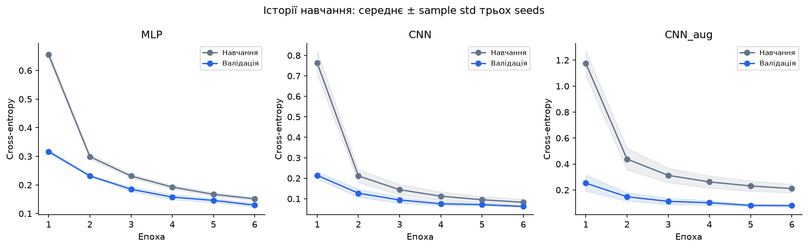
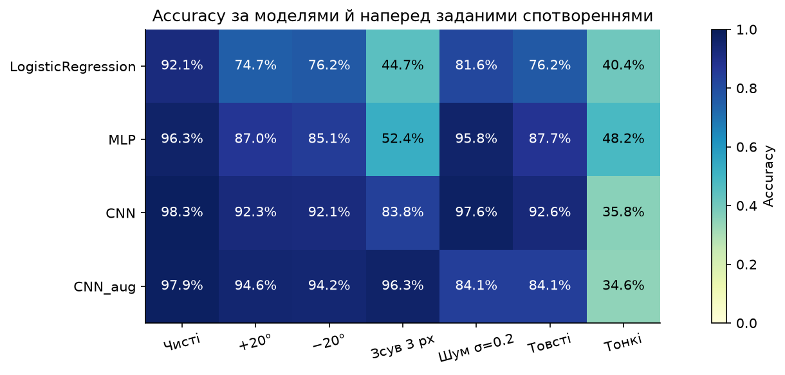
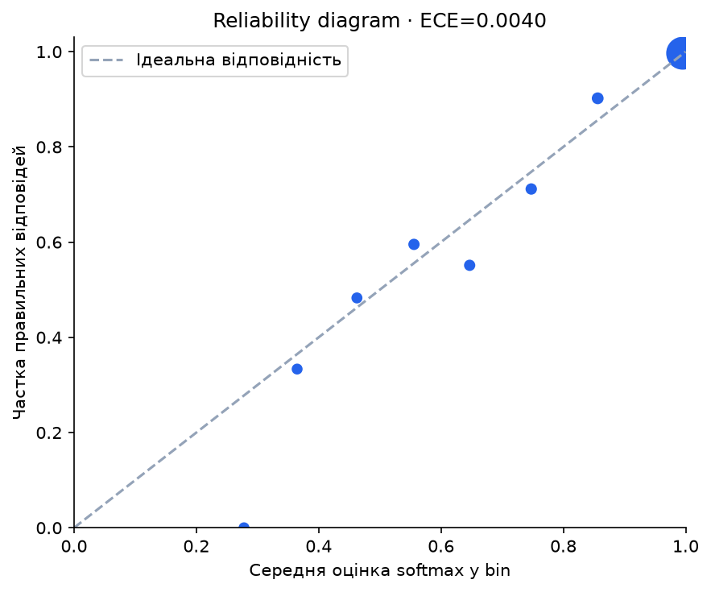
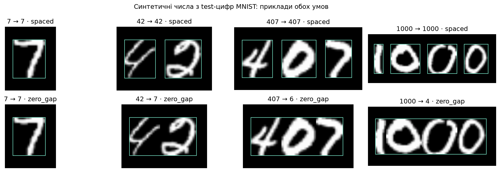

# Розпізнавання рукописних цифр: порівняння моделей і дослідження аугментації

Автор: ____________________ · Група: ____________________

## Анотація

Досліджено багатокласову класифікацію зображень цифр на MNIST. Порівняно логістичну регресію, багатошаровий перцептрон (MLP), згорткову нейромережу (CNN) і ту саму CNN з геометричною аугментацією. Кожний нейронний варіант навчено з трьома seeds. Вибір checkpoint здійснено за validation macro-F1, а test використано для фінального оцінювання. Усі наведені числа отримано виконанням коду, а не задано вручну. CNN без аугментації отримала середню accuracy 98.29%, CNN з аугментацією — 97.90%. На трьох заздалегідь визначених геометричних спотвореннях середня парна зміна accuracy становила +5.61 відсоткового пункту. Це результат обмеженого обчислювального експерименту, а не гарантія якості на довільних рукописних зображеннях.

## 1. Постановка задачі та гіпотези

Вхід — одноканальне зображення 28×28; вихід — один із класів 0–9. Це supervised multiclass classification. Перша гіпотеза: локальна структура зображення, яку враховує CNN, дає кращу якість за лінійний класифікатор при нашому бюджеті навчання. Друга, основна гіпотеза: геометрична аугментація покращує стійкість CNN до поворотів і зсувів. Окремо вимірюється ціна такої стійкості на чистих даних. Основна узагальнювальна stress-метрика — рівнозважене середнє accuracy для +20°, −20° і зсуву праворуч 3 px; вона не є оцінкою частоти цих умов у реальному житті. Шум і товщина штриха — додаткові, а не навчальні перетворення.

## 2. Дані й запобігання витоку

Офіційна навчальна частина MNIST має 60000 прикладів. Стратифікованим поділом із seed=42 виділено 50000 train і 10000 validation. Офіційні 10000 test не включено ні в навчання, ні у вибір епохи. Усі моделі використовують однакові індекси. Пікселі переводяться з 0…255 у 0…1; для нейромереж додаткове фіксоване перетворення переводить їх у −1…1. Середні або дисперсії на validation/test не оцінюються. Аугментація застосовується виключно до навчальних mini-batches; validation лишається чистою. Індекси розбиття та SHA-256 завантажених архівів збережено. Відтворюваність випадкового поділу не означає незалежності авторів почерку.

## 3. Моделі та навчання

Логістична регресія: C=1, L-BFGS, max_iter=300, tol=0.001, 784 вхідні ознаки. Це сильніший орієнтир, ніж випадковий прогноз; підбір параметрів цієї моделі не проводився. Модель sklearn отримує значення 0…1 без окремого StandardScaler.

MLP: Flatten → Linear(784,128) → ReLU → Dropout(0.2) → Linear(128,64) → ReLU → Linear(64,10).

CNN: Conv(1,8,3×3,padding=1) → ReLU → MaxPool(2) → Conv(8,16,3×3,padding=1) → ReLU → MaxPool(2) → Flatten → Linear(784,64) → ReLU → Dropout(0.2) → Linear(64,10). CNN_aug має ідентичну архітектуру.

Для всіх нейромереж: Adam, learning rate 0.001, weight_decay 0.0001, batch=256, шість епох, seeds 17/42/73. Функція втрат — CrossEntropyLoss над logits; softmax перед нею не застосовується. Градієнти обчислює autograd; крок оптимізації виконує готовий Adam. Для кожного запуску збережено checkpoint епохи з найбільшим validation macro-F1 (при рівності — раніша). Навчання триває всі шість епох: це вибір checkpoint, а не early stopping.

Для пар CNN/CNN_aug із тим самим seed початкові ваги ідентичні; їхні hashes збережено. DataLoader має незалежний generator для однакового порядку прикладів. Аугментація використовує окремий generator і не змінює потік випадковості dropout. Результати можуть залежати від бібліотек і процесора, тому версії зафіксовано. Використано CPU і два потоки PyTorch; однакова кількість епох не означає однакову кількість операцій чи час.

Train loss вимірюється під час оновлень ваг із активним dropout (і аугментацією для CNN_aug); validation loss — після епохи в eval-режимі на чистих зображеннях. Тому ці криві не є ідентичними умовами вимірювання, і їхній розрив не слід автоматично називати перенавчанням.

## 4. Аугментація та контрольовані спотворення

Під час навчання CNN_aug кожне зображення незалежно отримує випадковий поворот у ±15° та масштаб 0.9…1.1. Параметр зсуву оберненої нормалізованої сітки змінюється в ±0.2: без поєднання з масштабом і поворотом це відповідає приблизно ±10% ширини. За спільної афінної трансформації фактичний прямий зсув може бути більшим, тому test-зсув 3 px не оголошуємо поза навчальним діапазоном. Перетворення виконується бібліотечними affine_grid/grid_sample з bilinear interpolation і чорним фоном. Test-повороти ±20° виходять за навчальні ±15°. Це перевірка обмеженого перенесення стійкості, а не повторення тих самих навчальних картинок.

Додаткові умови: адитивний Gaussian noise σ=0.2 у шкалі 0…1 з обрізанням до [0,1]; dilation та erosion квадратним ядром 3×3. Такі морфологічні перетворення можуть бути сильними й змінювати читабельність, тому їхній результат не слід трактувати як стійкість до будь-якого природного почерку. Всі моделі отримують однакові спотворені зображення. Кожна умова є окремою і не накладається поверх попередньої. Моделі після test не переналаштовувалися.

## 5. Метрики та чистий test

Accuracy — частка правильних відповідей. Precision і recall обчислюються для кожної цифри; F1 — їх гармонічне середнє. Macro-F1 надає класам однакову вагу. Таблиця містить mean і sample std по трьох нейронних seeds; для єдиного запуску регресії std не визначено. Std між seeds описує варіативність навчання на фіксованому поділі, а не довірчий інтервал якості на всіх можливих даних.

| name | n | accuracy_mean | accuracy_std | macro_f1_mean | macro_f1_std |
| --- | --- | --- | --- | --- | --- |
| LogisticRegression | 1 | 0.9208 | — | 0.9197 | — |
| MLP | 3 | 0.9626 | 0.0025 | 0.9622 | 0.0025 |
| CNN | 3 | 0.9829 | 0.0014 | 0.9828 | 0.0014 |
| CNN_aug | 3 | 0.9790 | 0.0032 | 0.9790 | 0.0032 |

Середня різниця CNN − LogisticRegression на чистому test: +6.21 відсоткового пункту. Це порівняння конкретних архітектур і фіксованих налаштувань, а не доказ загальної переваги всіх нейронних мереж над усіма класичними алгоритмами. Повні per-class precision/recall/F1 збережені у CSV для кожного запуску.

## 6. Основний експеримент: ефект аугментації

| condition | delta_accuracy_mean | delta_accuracy_std |
| --- | --- | --- |
| clean | -0.0039 | 0.0027 |
| rotate_plus20 | 0.0226 | 0.0079 |
| rotate_minus20 | 0.0209 | 0.0054 |
| shift_right3 | 0.1249 | 0.0387 |
| noise_020 | -0.1344 | 0.0520 |
| thick | -0.0848 | 0.0188 |
| thin | -0.0119 | 0.0698 |

У таблиці різниці в частках (0.01 = один відсотковий пункт). Парні різниці рахуються спочатку всередині seed, потім усереднюються. За основною геометричною stress-метрикою аугментація **покращила** accuracy: mean Δ=+5.61 в.п., sample std=1.33 в.п. На чистому test mean Δ=-0.39 в.п. Три seeds не дають підстав стверджувати статистичну значущість або гарантувати знак ефекту на іншому поділі.

## 7. Аналіз помилок та оцінок softmax

Представника кожного сімейства для матриць помилок обрано за validation, без пошуку найкращого test seed. Для демонстрації за тим самим правилом обрано CNN, seed=42, епоха=6. На чистому test він має 172 помилок. Для його accuracy Wilson 95% interval: [98.01%; 98.52%] за припущення незалежних прикладів; цей інтервал не враховує навчальну випадковість або зміну домену.

Показано перші помилки в офіційному порядку test, а не підібрані вручну «гарні» приклади. Візуальна неоднозначність є можливою інтерпретацією, але не встановленою причиною. Діаграма надійності зі сталими десятьма bins дала ECE=0.0040; це лише описова, залежна від bins діагностика обраної моделі. Жодне калібрування на test не проводилося. Навіть високий softmax score не гарантує правильності для малюнка з іншого джерела.

## 8. Практична демонстрація

Локальний застосунок app.py приймає малюнок із canvas, обрізає порожній фон, вписує штрих у поле 20×20, доповнює до 28×28 і центрує за центром мас. Після тієї самої фіксованої нормалізації модель повертає top-3 softmax scores і зображення, яке вона отримала. Порожні та некоректні входи відхиляються. Модель завантажується зі збереженого checkpoint, сервер слухає лише 127.0.0.1. Малюнки не зберігаються. Власний UI — демонстрація, а не розмічений зовнішній benchmark; точність на намальованих користувачем цифрах тут не оцінювалася.

## 9. Обмеження та подальша робота

1. Шість епох — фіксований CPU-бюджет, а не доведена збіжність кожної моделі. CNN_aug може потребувати довшого навчання; висновки обмежені цим бюджетом.
2. Один train/validation split і три seeds оцінюють лише частину невизначеності. Повторні розбиття та незалежні автори почерку підсилили б висновки.
3. MNIST містить підготовлені зображення; фотографії мають інший фон, світло, перспективу. Для них потрібні дані й окреме оцінювання.
4. Геометрична аугментація не навчає модель автоматично стійкості до шуму чи морфології. Результати для цих умов потрібно читати окремо.
5. Логістична регресія не мала пошуку гіперпараметрів, а нейромережі мають одну архітектуру й оптимізатор. Порівняння не вичерпує класів моделей.
6. ECE залежить від розбиття на bins; Wilson interval припускає незалежність test-прикладів; жодна метрика не заміняє перевірки нового домену.

Подальші експерименти: більший наперед визначений бюджет, кілька незалежних split, контроль кожного типу аугментації окремо, оцінювання на розміченому наборі малюнків нових авторів. Вони не видаються за виконані результати цієї роботи.

## 10. Висновки

Реалізовано повний цикл: отримання даних, контрольований поділ, навчання бібліотечних моделей, вибір checkpoint за validation, незалежне test-оцінювання, парне дослідження аугментації, аналіз помилок і інтерактивне застосування. Основний результат — не лише accuracy, а виміряний компроміс чистої якості та стійкості: геометричний ефект +5.61 в.п. при зміні чистої accuracy на -0.39 в.п. Всі цифри можна перевірити за збереженими прогнозами, історіями та вагами.

## 11. Розширення: цілі числа від 1 до 1000

### Постановка та реалізація

Модель цифр повторно використано для розпізнавання послідовностей довжиною від однієї до чотирьох цифр. 1000 окремих класів не навчалися. Пайплайн: широке полотно → очищення фону → поділ за вертикальною проєкцією → впорядкування зліва направо → передобробка кожної цифри → CNN → об'єднання top-1 прогнозів → перевірка діапазону.

Полотно UI має 840×240 пікселів. Поріг foreground — 40 у шкалі 0…255; видаляються 8-зв'язні компоненти площею меншою за max(6,0.002×кількість foreground-пікселів). Сусідні зайняті вертикальні ділянки об'єднуються, якщо порожній проміжок не перевищує max(4 px, round(0.035×висота foreground)). Це допомагає зберігати розірвані штрихи однієї цифри, але може помилково об'єднати надто близькі цифри. Повертаються рамки [x,y,width,height], входи моделі й top-3 кожної цифри. Геометрична сегментація є передобробкою; алгоритми класифікації та градієнти з нуля не реалізуються.

Нуль, провідні нулі та значення понад 1000 відхиляються. Наприклад, прогноз 1001 показується як 1001 із поясненням недопустимого діапазону, а не замінюється на «найближче дозволене» число. Більше чотирьох виділених ділянок викликає повідомлення про помилку. Підтримувана умова — одне число в один рядок із проміжками; перекриття, дотик і багаторядковий ввід надійно не підтримуються.

### Протокол синтетичної перевірки

Для кожного цілого числа 1…1000 створено рівно одну композицію з випадково обраних цифр **офіційного test MNIST**, seed=829. Ті самі вибрані glyphs використано у двох умовах: проміжок 18 px і нульовий проміжок між bounding rectangles. Висота glyph — 72 px, полотно — 500×120. Параметри сегментації за результатами перевірки не підбиралися; ваги CNN не змінювалися. Використано checkpoint, раніше обраний лише за validation.

Нульовий проміжок означає сусідство рамок, але не гарантує фізичний контакт штрихів: крайні пікселі можуть бути на різних рядках. Умова є контрольним складним прикладом для методу, що спирається на порожні стовпці.

Основна метрика — **exact-number accuracy**: відповідь правильна, тільки якщо вся послідовність точно відповідає істині та проходить перевірку діапазону. Додатково вимірюються правильна кількість цифр і збіг усіх впорядкованих рамок із відомими межами (IoU≥0.8). Контроль oracle-crop отримує правильні рамки, але використовує **те саме очищене зображення й ту саму передобробку/CNN**; це дозволяє дослідити внесок автоматичного визначення меж. Відмінність двох accuracy не є математично точним розкладом усіх помилок: іноді неправильна межа може випадково дати правильний прогноз.

| Метрика | Проміжок 18 px | Нульовий проміжок |
|---|---:|---:|
| Кількість чисел | 1000 | 1000 |
| Повністю правильні числа | 906 | 9 |
| Exact-number accuracy | 90.60% | 0.90% |
| Правильна кількість цифр | 98.30% | 0.90% |
| Усі рамки мають IoU≥0.8 | 97.80% | 0.90% |
| Exact-number accuracy з відомими межами | 92.30% | 92.30% |
| Accuracy цифр з відомими межами | 97.30% | 97.30% |
| Відхилення за діапазоном | 24 | 20 |

### Інтерпретація й обмеження

Навіть при хорошому розпізнаванні окремих цифр помилка одного символу робить усе число неправильним. Результати з проміжками показують сумарну якість сегментації й CNN за цим синтетичним протоколом. Результат із нульовим проміжком демонструє очікувану слабкість вертикальної проєкції; його не приховано й не використано для післятестового налаштування.

Це **не benchmark справжнього написання багатозначних чисел**: glyphs написані окремо, масштаб і розміщення стандартизовані, природні лігатури не представлені. Source-цифри повторно використовуються між числами, тому приклади залежні; їх також раніше застосовано в основному test-експерименті. Штучні композиції не є новим незалежним джерелом даних. Інтервали, що трактують усі 1000 чисел як незалежні, не наводяться. Для реальної оцінки потрібні розмічені цілі числа від нових авторів із зафіксованими умовами збору.

Наступний крок — окремо зібрати та оцінити такий набір; для цифр, що зливаються, розглянути learned segmentation або sequence recognition. Ці можливості не видаються за вже реалізовані. Навчання базових моделей і їхні test-результати залишаються такими, як у головному експерименті.

## Джерела та відтворення

- [Torchvision MNIST](https://docs.pytorch.org/vision/stable/generated/torchvision.datasets.MNIST.html).
- [PyTorch: навчання моделей](https://docs.pytorch.org/tutorials/beginner/basics/quickstart_tutorial.html).
- [CrossEntropyLoss](https://docs.pytorch.org/docs/stable/generated/torch.nn.CrossEntropyLoss.html).
- [Grid sample](https://docs.pytorch.org/docs/stable/generated/torch.nn.functional.grid_sample.html).
- [scikit-learn: оцінювання](https://scikit-learn.org/stable/modules/model_evaluation.html).

Середовище фактичного запуску: {'python': '3.12.14', 'torch': '2.15.0+cpu', 'sklearn': '1.9.1', 'numpy': '2.5.4', 'pandas': '3.1.1', 'device': 'cpu', 'threads': 2}. Команди відтворення наведені в README. Артефакти містять конфігурацію, SHA-256 даних і checkpoint, індекси, історії, всі test-прогнози, таблиці та рисунки.
